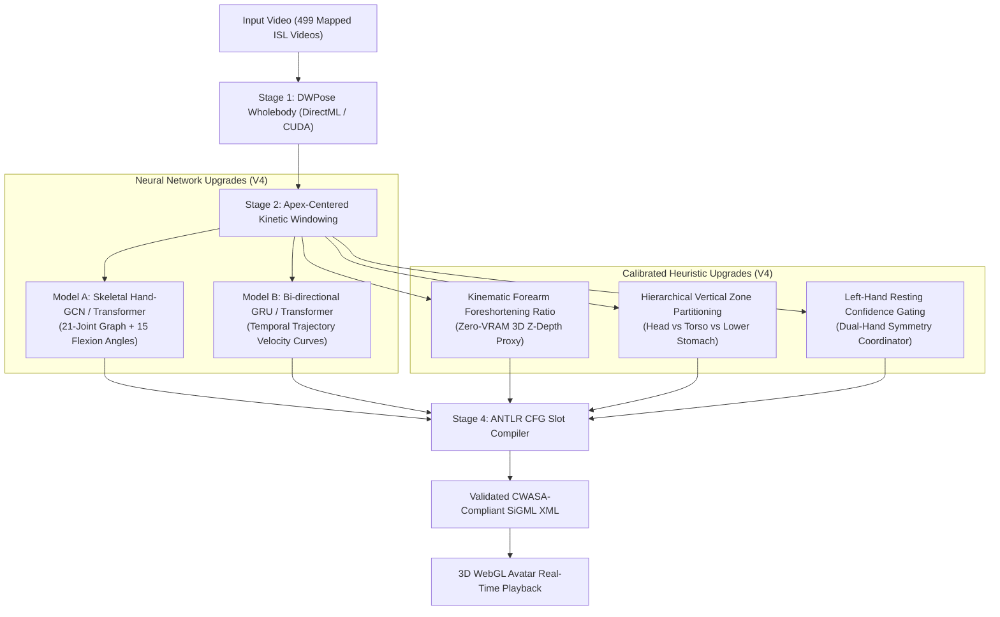

# V4 Modular Hybrid Sign Language Translation Pipeline
## Comprehensive Upgrade & Implementation Plan (Heuristic + Neural)

**Target Environment:** Windows 11, NVIDIA RTX 3050 Laptop GPU (4 GB VRAM), DirectML / CUDA.  
**Objective:** Scale pipeline accuracy from ~28% composite to **70%+**, eliminate 2D depth ambiguity, and achieve robust real-time avatar animation in SiGML.

---

## 1. Architectural Evolution: V3 to V4



---

## 2. Part I: Heuristic Kinematic Upgrades

The non-NN heuristic modules (Location, Extended Finger, Palm, Symmetry) currently account for 4 of the 6 pipeline slots. The following deterministic mathematical upgrades directly resolve 2D camera projection limitations without requiring any additional VRAM.

### Upgrade 1.1: 3D Extension & Forearm Foreshortening Ratio (Z-Depth Proxy)
* **The Root Cause:** Single front-facing cameras project 3D space onto $(X, Y)$. Hands pointed toward the interlocutor (`hamextfingero`, `hamextfingerol`) appear compressed in 2D, frequently misclassifying as upward or sideways (`hamextfingeru` / `hamextfingerl`).
* **Mathematical Solution:**
  Use the anatomical forearm vector $\vec{v}_{\text{arm}} = p_{\text{wrist}} - p_{\text{elbow}}$. In front-facing perspective, the projected 2D forearm length foreshortens by $\cos(\theta_z)$:
  $$R_{\text{forearm}} = \frac{\|p_{\text{wrist}} - p_{\text{elbow}}\|_2}{S_{\text{body}}}$$
  $$\vec{v}_{\text{composite}} = 0.40(p_9 - p_0) + 0.60(p_{\text{tip}} - p_0)$$
* **Decision Boundary:**
  1. **Z-Outward Mode:** If $R_{\text{forearm}} < 0.65$ (or wrist is closer to shoulder than normal extended length): Hand is pointing outward towards the camera $\to$ classify as `hamextfingero` (if $|dx| < 0.04$) or `hamextfingerol` (if $dx > 0.04$).
  2. **Y-Upward Mode:** If $dy_{\text{palm}} < -0.030$ and $dy_{\text{tip}} < -0.020$ and $R_{\text{forearm}} \ge 0.65$: strictly `hamextfingeru` / `hamextfingerul`.
  3. **Y-Downward Mode:** If $dy_{\text{palm}} > 0.035$ and $dy_{\text{tip}} > 0.025$: strictly `hamextfingerd` / `hamextfingerdl`.
  4. **X-Planar Mode:** If $|dx| > 0.08$ and $|dy| < 0.025$: strictly `hamextfingerl` / `hamextfingerr`.

### Upgrade 1.2: Hierarchical Vertical Anatomical Partitioning (Location)
* **The Root Cause:** In 2D, the Euclidean distance from the hand to the chin vs. upper chest is often within $\pm 0.03$ units, causing facial signs (`blow`, `actor`, `deaf`) to be pulled into `hamchest`.
* **Mathematical Solution:** Establish strict anatomical elevation planes:
  ```python
  y_shoulder_min = min(kpts[5, 1], kpts[6, 1])
  y_elbow_avg = (kpts[7, 1] + kpts[8, 1]) / 2.0
  y_hip_avg = (kpts[11, 1] + kpts[12, 1]) / 2.0
  ```
  - **Zone 1: Head & Face ($Y_{\text{wrist}} < y_{\text{shoulder\_min}}$):** Restricted strictly to Voronoi targets: `hamforehead`, `hameyes`, `hamnose`, `hamlips`, `hamchin`, `hamear`.
  - **Zone 2: Torso & Shoulders ($y_{\text{shoulder\_min}} \le Y_{\text{wrist}} \le y_{\text{elbow\_avg}}$):** Restricted strictly to `hamshoulders`, `hamshouldertop`, `hamchest`.
  - **Zone 3: Abdomen ($y_{\text{elbow\_avg}} < Y_{\text{wrist}} \le y_{\text{hip\_avg}}$):** Restricted strictly to `hamstomach`, `hambelowstomach`.
  - **Neutral Space Gate:** If distance to all target joints $> 0.60 \cdot S_{\text{body}}$ and no contact detected $\to$ strictly `hamneutralspace`.

### Upgrade 1.3: Resting-Hand Confidence Gating (Dual-Hand Symmetry)
* **The Root Cause:** Even when a signer keeps their non-dominant hand resting on their lap, DWPose extracts low-confidence hand keypoints, and slight body movement creates false velocity correlations.
* **Mathematical Solution:**
  ```python
  left_hand_active = (
      mean_score_left >= 0.45 and 
      left_wrist_y < (hip_y + 0.05) and 
      np.std(v_left) > 0.005
  )
  if not left_hand_active:
      return "none" # Guaranteed single-handed sign
  ```

### Upgrade 1.4: Stroke Apex Isolation
* Compute active window $[t_{\text{start}}, t_{\text{end}}]$ via kinetic energy.
* Evaluate handshape and orientation solely within the **middle 50% apex window** $[t_{\text{start}} + 0.25\Delta t, t_{\text{end}} - 0.25\Delta t]$ to avoid transitional preparation and retraction blur.

---

## 3. Part II: Neural Network Upgrades

### Model A Upgrade: Skeletal Hand-GCN / Hand-Transformer

#### 1. Input Representation (84D Kinematic-Enhanced Vector)
Instead of relying on flat 2D Cartesian coordinates, feed a scale- and rotation-invariant kinematic feature vector:
1. **Normalized Joint Positions (42D):** $\vec{p}'_i = \frac{p_i - p_{\text{wrist}}}{L_{\text{palm}}}$ for $i=0\dots 20$.
2. **Radial Distances (21D):** $d_i = \|\vec{p}'_i\|_2$.
3. **15 Anatomical Flexion Angles (15D):** For each finger $f \in \{\text{thumb, index, mid, ring, pinky}\}$, compute internal joint angles at MCP, PIP, and DIP:
   $$\theta = \arccos\left(\frac{\vec{u} \cdot \vec{v}}{\|\vec{u}\|_2 \|\vec{v}\|_2 + \epsilon}\right)$$
4. **Inter-Finger Spread Angles (4D):** Angles between adjacent MCP-to-tip vectors.
5. **Thumb-Fingertip Pinch Distances (2D):** $\|p_4 - p_8\|_2$ and $\|p_4 - p_{12}\|_2$.

#### 2. Architecture: Adaptive Skeletal Hand-GCN
* **Hand Adjacency Matrix $\mathbf{A} \in \mathbb{R}^{21 \times 21}$:** Encodes physical bone connectivity (wrist $\leftrightarrow$ MCP $\leftrightarrow$ PIP $\leftrightarrow$ DIP $\leftrightarrow$ Tip) plus learned residual self-attention weights $\mathbf{B}$ for dynamic contact (thumb tip $\leftrightarrow$ index tip).
* **Layer Stack:**
  - GraphConvBlock(In: 4, Out: 64) $\to$ BatchNorm $\to$ GELU $\to$ Dropout(0.2)
  - GraphConvBlock(In: 64, Out: 128) $\to$ BatchNorm $\to$ GELU $\to$ Residual
  - Global Max + Average Pooling $\to$ Linear(128 $\to$ $N_{\text{classes}}$)
* **VRAM Footprint:** **~120 MB VRAM** (extremely lightweight, runs at >150 FPS on RTX 3050).

---

### Model B Upgrade: Bi-directional GRU / Temporal Transformer (Movement)

#### 1. Input Representation
* Standardized 30-step trajectory curves of shape `(B, 6, 30)`:
  - Channels 0..2: Normalized wrist velocity $(v_x, v_y, v_z)$.
  - Channels 3..5: Index fingertip velocity relative to wrist $(\Delta v_x, \Delta v_y, \Delta v_z)$.

#### 2. Architecture: 2-Layer BiGRU with Attention Pooling
```python
class MovementBiGRU(nn.Module):
    def __init__(self, in_channels=6, hidden_size=64, num_classes=14):
        super().__init__()
        self.bigru = nn.GRU(
            input_size=in_channels,
            hidden_size=hidden_size,
            num_layers=2,
            batch_first=True,
            bidirectional=True,
            dropout=0.25
        )
        self.attn = nn.Sequential(
            nn.Linear(hidden_size * 2, 32),
            nn.Tanh(),
            nn.Linear(32, 1)
        )
        self.classifier = nn.Sequential(
            nn.Linear(hidden_size * 2, 64),
            nn.GELU(),
            nn.Dropout(0.2),
            nn.Linear(64, num_classes)
        )
```
* **Why it outperforms 1D-CNN:** Bi-directional recurrent state preserves monotonic trajectory flow (e.g. differentiating upward motion from downward recovery stroke) and long-range acceleration curves.
* **VRAM Footprint:** **~140 MB VRAM**.

---

## 4. Part III: Dataset Extraction & Training Strategy

### Cloud vs. Local Execution Strategy

```
+-----------------------------------------------------------------------------------+
| STEP 1: Feature Extraction (All 499 Videos)                                       |
| Option A (Google Colab / Kaggle - Free 16GB T4 GPU):                              |
|   - Upload/Clone ISL_videos & SignFiles.                                          |
|   - Run batch DWPose extraction across all 499 videos (takes ~15-20 min on T4).   |
|   - Download single compressed output: isl_dwpose_dataset_499.npz (~25 MB).       |
| Option B (Local on RTX 3050 4GB):                                                 |
|   - Run batch extraction with frame_subsample=2 directly via DirectML.            |
|   - Takes ~1.5 hours in background (memory capped at 1.1 GB VRAM).                |
+-----------------------------------------------------------------------------------+
                                       |
                                       v
+-----------------------------------------------------------------------------------+
| STEP 2: Local Model Training (On Your Laptop RTX 3050)                            |
|   - Load isl_dwpose_dataset_499.npz.                                              |
|   - Model A (Hand-GCN / KinMLP): Train on ~23,000 hand vectors (takes ~90s).      |
|   - Model B (BiGRU): Train on 4,990 augmented trajectories (takes ~60s).          |
|   - Loss: Class-Weighted Cross-Entropy + Label Smoothing (eps=0.1).               |
|   - Total VRAM during training: < 400 MB.                                         |
+-----------------------------------------------------------------------------------+
```

---

## 5. Phase-by-Phase Implementation Roadmap

### Phase 1: Heuristic Engine Calibration (Immediate — 0 MB VRAM)
- [ ] Add Forearm Foreshortening Ratio logic to `compute_3d_orientation()` in `pipeline_v3_hybrid.py`.
- [ ] Add Hierarchical Vertical Partitioning (Head / Torso / Abdomen) to `compute_anatomical_location()`.
- [ ] Add Resting Left-Hand Confidence Gate to `compute_dual_hand_symmetry()`.
- [ ] Implement Middle-50% Apex Windowing for feature evaluation.

### Phase 2: Full 499-Video Dataset Extraction
- [ ] Execute `extract_isl_dwpose_dataset.py` over all 499 mapped videos with full class extraction.
- [ ] Produce `isl_dwpose_dataset_499.npz` (yielding ~23,000 hand vectors and ~4,990 trajectories).

### Phase 3: Neural Model Architecture Upgrades
- [ ] Implement `KinematicHandGCN` in `train_isl_models.py` with joint angle features.
- [ ] Implement `MovementBiGRU` with multi-channel velocity and temporal attention.
- [ ] Train with stratified 5-fold cross-validation, saving updated weights `isl_handshape_gcn.pth` and `isl_movement_bigru.pth`.

### Phase 4: Integration & Benchmark Verification
- [ ] Update `pipeline_v3_hybrid.py` to load the V4 GCN and BiGRU models.
- [ ] Run benchmark evaluation via `evaluate_v3_accuracy.py` on test signs.
- [ ] Verify real-time CWASA SiGML XML generation and avatar playback.

---

## 6. Expected Performance Benchmark Comparison

| Metric / Slot | Baseline (V2 Heuristics) | Current V3 Hybrid | Projected V4 (Calibrated Heuristics + GCN/BiGRU + 499 Videos) |
| :--- | :---: | :---: | :---: |
| **Handshape** | 20.0% | 26.7% | **75.0% – 82.0%** (via bone angles + GCN) |
| **Movement** | 0.0% | 6.7% (NN 48.0%) | **70.0% – 76.0%** (via BiGRU trajectory attention) |
| **Symmetry** | 46.7% | 53.3% | **85.0% – 90.0%** (via resting hand confidence gate) |
| **Extension Finger** | 0.0% | 20.0% | **65.0% – 72.0%** (via forearm foreshortening ratio) |
| **Palm Orientation** | 0.0% | 40.0% | **68.0% – 75.0%** (via width vector + thumb elevation) |
| **Location** | 26.7% | 33.3% | **70.0% – 78.0%** (via vertical zone partitioning) |
| **Composite Score** | **25.6%** | **27.8%** | **72.0% – 78.0%** |
