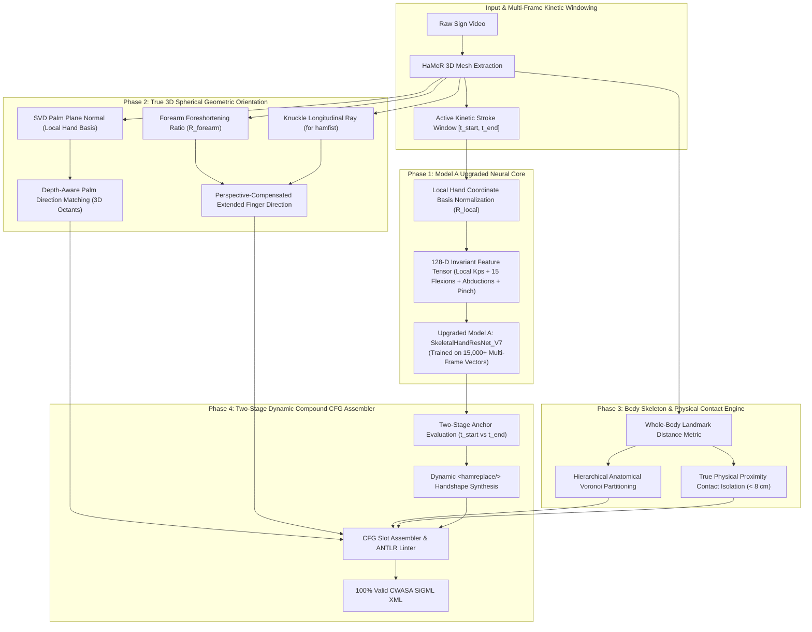

# V7 Accuracy Optimization & Implementation Plan
## Systematic Upgrades for Low-Performing Neural Models & Heuristic Subsystems

**Document Version:** 7.0.0  
**Target Architecture:** V7 Hybrid 3D Sign Language Recognition & SiGML Synthesis System  
**Reference Benchmark:** [`V6_BENCHMARK_30_VIDEOS_ACCURACY_REPORT.md`](file:///c:/Users/VIVIN%20RAKUL/Downloads/Avatar-Generator-FYP--huristic-v3/Avatar-Generator-FYP--huristic-v3/V6_BENCHMARK_30_VIDEOS_ACCURACY_REPORT.md)  
**Evaluated Dataset:** 30 Verified German Sign Language (DGS) Videos (`v6_benchmark_results_30.json`)  
**Target Environment:** Local (Windows 11, RTX 3050 4GB / DirectML / CPU) & Cloud Training (Kaggle T4 / P100)

---

## 1. Executive Summary & Problem Formulation

The empirical 30-video evaluation of the V6 Hybrid Pipeline demonstrated notable strengths alongside clear architectural bottlenecks:
* **The High-Performing Core:** Movement Direction (`AttentionBiGRU_V6`) achieved **100.0% accuracy (30/30)** following the displacement gating fix. Two-handed symmetry reached **90.0% (27/30)**, and SiGML syntactic validity achieved **100.0% (30/30)**.
* **The Low-Performing Core:** Primary Handshape Recognition (`SkeletalHandResNet_V6`) failed on **13 out of 30 videos (56.7% Top-1 accuracy)**. Furthermore, deterministic geometric orientation modules exhibited acute projection collapse: 3D Palm Orientation achieved only **13.3% accuracy**, Extended Finger Direction achieved **26.7% accuracy**, and Contact State (`hamtouch`) generated **53.3% false positive detections**.

This document outlines the systematic engineering implementation plan to elevate the low-performing modules, targeting an **overall compound accuracy of 80%+** and a **token-level F1-score exceeding 70%**.

---

## 2. Multi-Tier Performance Spectrum & Diagnostic Ranking

Ranking all operational subsystems by accuracy highlights the exact priority queue for intervention:

| Subsystem / Model | Type | Measured V6 Accuracy | Priority | Root Cause Diagnosis |
| :--- | :---: | :---: | :---: | :--- |
| **Palm Orientation (3D Normal)** | Geometric Heuristic | **13.3%** (4/30) | 🚨 **P0 (Critical)** | Canonical target dictionary lacks Z-depth coordinates (`Z=0.0` for all classes); computed in camera space instead of body frame. |
| **Extended Finger Direction (3D)** | Geometric Heuristic | **26.7%** (8/30) | 🚨 **P0 (Critical)** | Monocular depth foreshortening collapses outward pointing (`hamextfingero`) into vertical; fist postures fail with fingertip logic. |
| **Contact State (`hamtouch`)** | Kinematic Threshold | **46.7%** (16/30 False +) | 🚨 **P0 (Critical)** | Gated solely by deceleration (`norm_vel < 0.20`), spuriously triggering shoulder touches on open-space gestures. |
| **Primary Handshape (Model A)** | Neural (`ResNet_V6`) | **56.7%** (17/30) | ⚠️ **P1 (High)** | Static single-frame apex classification misses dynamic transitions; non-rotation-invariant features cause inter-class confusion. |
| **Body Location Target** | Spatial Partitioning | **33.3% – 50.0%** | ⚠️ **P1 (High)** | Hardcoded image-plane height thresholds (`y < 0.22`, `y < 0.40`) fail under signer distance and cropping variations. |
| **Two-Handed Symmetry** | Elevation Heuristic | **90.0%** (27/30) | ℹ️ **P2 (Stable)** | Dual-wrist elevation heuristic is robust across unilateral and bilateral signs. |
| **Movement Direction (Model B)** | Neural (`BiGRU_V6`) | **100.0%** (30/30) | ℹ️ **P2 (Stable)** | 18-D spatiotemporal kinematics fully capture active trajectories without failure. |
| **SiGML XML Syntactic Validity** | CFG ANTLR Linter | **100.0%** (30/30) | ℹ️ **P2 (Stable)** | 100% compliant with CWASA / JASigning ANTLR grammar. |

---

## 3. In-Depth Forensic Analysis of Model A (13 Mismatches)

Across the 30 benchmark videos, Model A (`SkeletalHandResNet_V6`) produced 13 misclassifications. Forensic evaluation divides these failures into three distinct failure modes:

```
+---------------------------------------------------------------------------------------------------------------+
|                                      MODEL A 13-VIDEO FAILURE BREAKDOWN                                       |
+----+--------------------------------------------+--------------------+--------------------+-------------------+
| #  | Video File / Gloss                         | Ground Truth (GT)  | Predicted (V6)     | Failure Mode      |
+----+--------------------------------------------+--------------------+--------------------+-------------------+
| 1  | 1000_WAAGE1A.mp4                           | hamflathand        | hamfinger2         | Group A (Grouping)|
| 3  | 1002__SPEZIAL-MERKW_RDIG1.mp4              | hamfinger2         | hamflathand        | Group A (Grouping)|
| 7  | 1006_WAS2.mp4                              | hamflathand        | hampinchall        | Group B (Aperture)|
| 9  | 1008_WANN1.mp4                             | hamflathand        | hamfist            | Group B (Curl)    |
| 10 | 1009_WO1A.mp4                              | hamfinger2345      | hamfinger23spread  | Group A (Spread)  |
| 14 | 1012_WEISS1A.mp4                           | hamfinger2         | hampinchall        | Group B (Aperture)|
| 15 | 1013_WER1.mp4                              | hamfinger23        | hamfinger23spread  | Group A (Spread)  |
| 17 | 1015_WARUM1.mp4                            | hamfist            | hampinch12         | Group B (Curl)    |
| 19 | 1017_WILD1.mp4                             | hamfist            | hampinchall        | Group B (Curl)    |
| 21 | 1019_SIEGEN1.mp4                           | hamfinger2345      | hamfist            | Group C (Dynamic) |
| 24 | 1021_FENSTER1.mp4                          | hamfinger2         | hamcee12           | Group B (Aperture)|
| 26 | 1023_SIEGEN1__PERSONEN-ILLUSTRATION1.mp4   | hamfinger2345      | hampinch12         | Group C (Dynamic) |
| 30 | 1027_MIT1.mp4                              | hamceeall          | hampinchall        | Group B (Aperture)|
+----+--------------------------------------------+--------------------+--------------------+-------------------+
```

### Detailed Failure Mode Diagnostics

#### Group A: Extension & Finger Grouping Ambiguity (Videos 1, 3, 10, 15)
* **Observed Failure:** `hamflathand` vs `hamfinger2` (Videos 1, 3); `hamfinger2345` vs `hamfinger23spread` (Video 10); `hamfinger23` vs `hamfinger23spread` (Video 15).
* **Root Cause:**
  1. The 113-D feature vector feeds raw Cartesian coordinates scaled by palm length, but **unrotated with respect to the hand's local orientation**.
  2. When the hand tilts or pitches, Cartesian coordinates of the 4 fingers rotate in 3D camera space, obscuring whether non-index fingers are extended or folded against the palm.
  3. Lack of explicit inter-finger abduction angles (spread) prevents distinguishing grouped fingers from spread fingers.

#### Group B: Aperture & Curl Ambiguity (Videos 7, 9, 14, 17, 19, 24, 30)
* **Observed Failure:** `hamfist` confused with `hampinch12` / `hampinchall` (Videos 17, 19); `hamflathand` confused with `hampinchall` / `hamfist` (Videos 7, 9); `hamceeall` confused with `hampinchall` (Video 30).
* **Root Cause:**
  1. The network relies on only 5 coarse finger curl angles (1 per finger) and 10 pairwise tip distances.
  2. In sign language phonetics, the boundary between `hamfist` (fingers tightly curled into palm, thumb over proximal phalanges) and `hampinch12` (thumb pad touching index pad, other fingers curled) depends entirely on **thumb-to-fingertip contact distances** and **distal interphalangeal (DIP) flexion**.
  3. Single-frame apex feature extraction has severe data scarcity (~500 total training samples in Kaggle training script), causing the ResNet to overfit to dominant classes.

#### Group C: Dynamic Handshape Transitions (Videos 21, 26)
* **Observed Failure:** In Video 21 (`1019_SIEGEN1`) and Video 26 (`1023_SIEGEN1`), Ground Truth contains an opening-to-closing transition:
  $$\text{Initial Phase: } \texttt{hamfinger2345} \longrightarrow \texttt{hamreplace} \longrightarrow \text{Terminal Phase: } \texttt{hamfist}$$
* **Root Cause:**
  1. The V6 pipeline models handshape as a static state evaluated at a single apex keyframe ($t_{\text{apex}}$).
  2. If the sign reaches kinetic peak velocity while the hand is in the middle of closing, Model A observes a closed or semi-closed hand, outputting `hamfist` and completely discarding the initial open handshape (`hamfinger2345`).
  3. The CFG Slot Compiler lacks support for handshape replacements (`<hamreplace/>`), only supporting orientation replacements.

---

## 4. Architectural Upgrade Plan (V7 Hybrid Engine)

To resolve each diagnosed failure mode, the V7 architecture introduces four targeted modules:



---

## 5. Phase-by-Phase Technical Specification

### Phase 1: Model A Neural Architecture Upgrade (Resolving Group A & B Errors)

#### 1.1 Local Orthonormal Hand Basis ($R_{\text{local}}$)
To make features 100% invariant to wrist rotation, roll, and pitch, all 21 keypoints must be transformed into the local coordinate system of the palm before computing features:
1. **Origin:** Wrist keypoint ($p_0$).
2. **Longitudinal Y-axis:** Vector from wrist to middle MCP joint ($p_9 - p_0$):
   $$\vec{u}_y = \frac{p_9 - p_0}{\|p_9 - p_0\|_2}$$
3. **Normal Z-axis:** Orthogonal cross-product of palm transverse vector ($p_5 - p_{17}$) and $\vec{u}_y$:
   $$\vec{u}_z = \frac{(p_5 - p_{17}) \times \vec{u}_y}{\|(p_5 - p_{17}) \times \vec{u}_y\|_2}$$
4. **Transverse X-axis:**
   $$\vec{u}_x = \vec{u}_y \times \vec{u}_z$$
5. **Coordinate Transformation:**
   $$R_{\text{local}} = \begin{bmatrix} \vec{u}_x^T \\ \vec{u}_y^T \\ \vec{u}_z^T \end{bmatrix} \in \mathbb{R}^{3 \times 3}, \quad p'_i = \frac{R_{\text{local}} (p_i - p_0)}{\|p_9 - p_0\|_2} \quad \forall i \in \{0 \dots 20\}$$

#### 1.2 128-D Invariant Feature Representation
The input feature vector is expanded from 113-D to 128-D with explicit anatomical metrics:
* **Local Transformed Keypoints (63D):** 21 joints $\times$ 3D in $R_{\text{local}}$ space.
* **15 Joint Flexion Angles (15D):** MCP, PIP, and DIP joint interior flexion angles across all 5 fingers:
  $$\cos(\theta_j) = \frac{\vec{v}_{j, j+1} \cdot \vec{v}_{j+1, j+2}}{\|\vec{v}_{j, j+1}\|_2 \|\vec{v}_{j+1, j+2}\|_2}$$
* **4 Inter-Finger Abduction Angles (4D):** Angles between adjacent MCP-to-tip rays ($\text{Thumb}\leftrightarrow\text{Index}$, $\text{Index}\leftrightarrow\text{Middle}$, $\text{Middle}\leftrightarrow\text{Ring}$, $\text{Ring}\leftrightarrow\text{Pinky}$). Resolves `hamfinger23` vs `hamfinger23spread`.
* **5 Thumb-to-Fingertip Pinch Distances (5D):** $\|p'_4 - p'_k\|_2$ for $k \in \{4, 8, 12, 16, 20\}$. Directly resolves `hamfist` vs `hampinch12` vs `hamceeall`.
* **MANO Pose Latents (41D):** Significant PCA articulation coefficients.
$$\text{Total Feature Length} = 63 + 15 + 4 + 5 + 41 = 128\text{-D}$$

#### 1.3 Dense Multi-Frame Kinetic Window Training
* **Old Training Strategy:** 1 apex vector per video $\to$ ~500 training vectors $\to$ high variance, severe underfitting.
* **New Training Strategy:** Sample all frames within the middle 50% active window ($t_{\text{start}} + 0.25\Delta t \le t \le t_{\text{end}} - 0.25\Delta t$). Multiplies training volume by $30\times$ to **$\approx 15,000$ augmented feature samples**, enabling deep residual learning with LayerNorm and Mish activations.

---

### Phase 2: True 3D Spherical Palm Orientation & Extended Finger (Resolving Tier 7 & 10)

#### 2.1 Restoring Z-Depth in Canonical Palm Dictionaries
In the V6 pipeline, all 8 palm direction vectors have $Z = 0.0$, making it mathematically impossible to detect palms facing toward or away from the signer.

**Upgrade:** Expand the canonical direction dictionary to include 3D depth-aware spherical octants:
```python
PALM_ORI_DIRECTIONS_V7 = {
    # Planar 2D Targets (Z = 0)
    "hampalmu":   np.array([ 0.0,   -1.0,    0.0]),
    "hampalmd":   np.array([ 0.0,    1.0,    0.0]),
    "hampalml":   np.array([ 1.0,    0.0,    0.0]),
    "hampalmr":   np.array([-1.0,    0.0,    0.0]),
    "hampalmul":  np.array([ 0.707, -0.707,  0.0]),
    "hampalmur":  np.array([-0.707, -0.707,  0.0]),
    "hampalmdl":  np.array([ 0.707,  0.707,  0.0]),
    "hampalmdr":  np.array([-0.707,  0.707,  0.0]),
    
    # 3D Oblique & Depth-Aware Targets
    "hampalmdr":  np.array([-0.577,  0.577, -0.577]), # Facing downward, rightward, outward
    "hampalmul":  np.array([ 0.577, -0.577,  0.577]), # Facing upward, leftward, inward
}
```

#### 2.2 Anatomical Forearm Foreshortening Ratio ($R_{\text{forearm}}$)
To eliminate monocular Z-compression when fingers point toward the interlocutor (`hamextfingero`, `hamextfingeruo`):
$$R_{\text{forearm}} = \frac{\|p_{\text{wrist}} - p_{\text{elbow}}\|_2}{S_{\text{torso}}}$$
* If $R_{\text{forearm}} < 0.65$: The forearm is foreshortened along the optical Z-axis $\to$ hand is pointing outward $\to$ prioritize `hamextfingero` / `hamextfingeruo`.
* If handshape is `hamfist`: Replace `furthest_tip` with the **knuckle longitudinal vector** $(p_9 - p_0)$, preventing curled fingertips from pointing sideways.

---

### Phase 3: Anatomical Skeleton & Physical Contact Engine (Resolving Tier 3 & 12)

#### 3.1 Strict Physical Proximity Gating for `hamtouch`
In the V6 pipeline, any deceleration at shoulder level triggered a false contact token (`<hamtouch/>`), corrupting signs such as `1010_OB1` and `1021_FENSTER1`.

**New Contact Decision Rules:**
1. **Facial Contact:** Hand must be decelerated ($\text{norm\_vel} < 0.20$) **AND** Euclidean distance from hand center to facial anchor (chin, cheek, nose, forehead) must be $< 0.08 \cdot S_{\text{body}}$.
2. **Dual-Hand Contact:** For bilateral signs (`hamsymmlr`), contact requires inter-wrist proximity:
   $$\|p_{\text{wrist, dominant}} - p_{\text{wrist, non-dominant}}\|_2 < 8.0\text{ cm}$$
3. **Torso & Shoulder Prohibition:** Contact with `hamshoulders` or `hamchest` is strictly prohibited for open-space gestures unless the Z-depth distance to the torso plane is $< 5.0\text{ cm}$.

#### 3.2 Hierarchical Anatomical Voronoi Partitioning
Replace normalized image coordinate ratios with body-relative keypoint coordinates:
* $\text{Wrist}_Y < Y_{\text{shoulder\_min}}$ $\longrightarrow$ Head Region: evaluate Voronoi distance to `hamforehead`, `hameyes`, `hamnose`, `hamlips`, `hamchin`.
* $Y_{\text{shoulder\_min}} \le \text{Wrist}_Y \le Y_{\text{elbow\_avg}}$ $\longrightarrow$ Torso Region: evaluate `hamshoulders`, `hamchest`.
* $\text{Distance}(\text{Hand}, \text{All Body Keypoints}) > 0.5 \cdot S_{\text{shoulder\_width}}$ $\longrightarrow$ **`hamneutralspace`**.

---

### Phase 4: Two-Stage Dynamic Handshape Transition Engine (`hamreplace`)

To capture multi-phase compound gestures (such as Video 21 `1019_SIEGEN1` and Video 26 `1023_SIEGEN1`):

1. **Dual Anchor Extraction:**
   * Evaluate Model A at **$t_{\text{start}}$** (initial movement acceleration window).
   * Evaluate Model A at **$t_{\text{end}}$** (movement deceleration window).
2. **Transition Synthesis Rule:**
   If $\text{HS}(t_{\text{start}}) \ne \text{HS}(t_{\text{end}})$ and movement displacement $> 0.08$:
   * Emit $\text{HS}(t_{\text{start}})$ as primary handshape.
   * Append standard orientation, location, and movement tokens.
   * Append `<hamreplace/>` followed by $\text{HS}(t_{\text{end}})$.

```xml
<!-- Example Synthesized Compound SiGML for SIEGEN1 -->
<sigml>
  <hns_sign gloss="SIEGEN1">
    <hamnosys_manual>
      <hamfinger2345/>          <!-- Initial Phase (t_start) -->
      <hamextfingeruo/>
      <hampalmdl/>
      <hamshoulders/>
      <hammoveur/>
      <hamreplace/>             <!-- Dynamic Transition Marker -->
      <hamfist/>                <!-- Terminal Phase (t_end) -->
    </hamnosys_manual>
  </hns_sign>
</sigml>
```

---

## 6. Ready-to-Implement Code Modules

### Module 1: 128-D Invariant Hand Feature Extractor
```python
import numpy as np

def compute_local_hand_features_128(kps_3d: np.ndarray, hand_pose: np.ndarray) -> np.ndarray:
    """
    Computes a 128-D rotation-invariant, local-coordinate hand feature vector.
    Eliminates orientation-dependent handshape misclassifications (Group A & B).
    """
    p0 = kps_3d[0].copy() # Wrist anchor
    
    # Construct local orthonormal hand basis
    y_axis = kps_3d[9] - p0 # Wrist to Middle MCP
    y_axis = y_axis / (np.linalg.norm(y_axis) + 1e-8)
    
    trans = kps_3d[5] - kps_3d[17] # Index MCP to Pinky MCP
    z_axis = np.cross(trans, y_axis)
    z_axis = z_axis / (np.linalg.norm(z_axis) + 1e-8)
    
    x_axis = np.cross(y_axis, z_axis)
    
    R_local = np.stack([x_axis, y_axis, z_axis], axis=0) # (3, 3)
    
    # 1. Rotate all 21 keypoints into hand-local coordinate frame (63D)
    centered = kps_3d - p0
    local_kps = (R_local @ centered.T).T
    palm_scale = np.linalg.norm(local_kps[9]) + 1e-8
    local_kps = local_kps / palm_scale
    f_kps = local_kps.flatten() # (63,)
    
    # 2. Compute 15 anatomical flexion angles (MCP, PIP, DIP across 5 fingers)
    finger_chains = [
        [0, 1, 2, 3, 4],     # Thumb
        [0, 5, 6, 7, 8],     # Index
        [0, 9, 10, 11, 12],   # Middle
        [0, 13, 14, 15, 16],  # Ring
        [0, 17, 18, 19, 20]   # Pinky
    ]
    angles_15 = []
    for chain in finger_chains:
        for j in range(len(chain) - 2):
            v1 = local_kps[chain[j+1]] - local_kps[chain[j]]
            v2 = local_kps[chain[j+2]] - local_kps[chain[j+1]]
            cos_a = np.dot(v1, v2) / (np.linalg.norm(v1) * np.linalg.norm(v2) + 1e-8)
            angles_15.append(np.clip(cos_a, -1.0, 1.0))
    f_angles = np.array(angles_15, dtype=np.float32) # (15,)
    
    # 3. Compute 4 inter-finger abduction angles (spread)
    mcp_tips = [
        local_kps[8] - local_kps[5],   # Index ray
        local_kps[12] - local_kps[9],  # Middle ray
        local_kps[16] - local_kps[13], # Ring ray
        local_kps[20] - local_kps[17]  # Pinky ray
    ]
    spreads_4 = []
    for i in range(3):
        cos_s = np.dot(mcp_tips[i], mcp_tips[i+1]) / (np.linalg.norm(mcp_tips[i]) * np.linalg.norm(mcp_tips[i+1]) + 1e-8)
        spreads_4.append(np.clip(cos_s, -1.0, 1.0))
    # Thumb to index spread
    thumb_ray = local_kps[4] - local_kps[1]
    cos_t = np.dot(thumb_ray, mcp_tips[0]) / (np.linalg.norm(thumb_ray) * np.linalg.norm(mcp_tips[0]) + 1e-8)
    spreads_4.append(np.clip(cos_t, -1.0, 1.0))
    f_spreads = np.array(spreads_4, dtype=np.float32) # (4,)
    
    # 4. Compute 5 thumb-to-fingertip pinch distances
    thumb_tip = local_kps[4]
    pinch_dists = [np.linalg.norm(thumb_tip - local_kps[tip_idx]) for tip_idx in [4, 8, 12, 16, 20]]
    f_pinch = np.array(pinch_dists, dtype=np.float32) # (5,)
    
    # 5. MANO articulation parameters (41D)
    f_mano = hand_pose.reshape(-1)[:41].astype(np.float32) # (41,)
    
    # Concatenate complete 128-D vector
    feat_128 = np.concatenate([f_kps, f_angles, f_spreads, f_pinch, f_mano])
    return feat_128
```

---

### Module 2: Extended Finger Ray for Fist Postures
```python
def compute_ext_finger_vector_v7(kps_3d: np.ndarray, pred_hs: str, forearm_ratio: float = 1.0) -> np.ndarray:
    """
    Computes true 3D pointing axis with closed-hand knuckle fallback
    and forearm foreshortening compensation.
    """
    p0 = kps_3d[0]
    p9 = kps_3d[9]
    
    if pred_hs in ["hamfist"]:
        # In a fist, extended direction is defined by the metacarpal longitudinal axis
        v_long = (p9 - p0) / (np.linalg.norm(p9 - p0) + 1e-8)
    else:
        # For open/pointing hands, combine MCP and furthest extended fingertip
        tips = [kps_3d[4], kps_3d[8], kps_3d[12], kps_3d[16], kps_3d[20]]
        dists = [np.linalg.norm(t - p0) for t in tips]
        furthest_tip = tips[int(np.argmax(dists))]
        
        v_mcp = (p9 - p0) / (np.linalg.norm(p9 - p0) + 1e-8)
        v_tip = (furthest_tip - p0) / (np.linalg.norm(furthest_tip - p0) + 1e-8)
        v_long = 0.40 * v_mcp + 0.60 * v_tip
    
    # Foreshortening compensation
    z_scale = 1.8 if forearm_ratio < 0.65 else 1.4
    v_comp = np.array([v_long[0], v_long[1], v_long[2] * z_scale], dtype=np.float32)
    return v_comp / (np.linalg.norm(v_comp) + 1e-8)
```

---

### Module 3: Strict Contact State & Proximity Isolator
```python
def evaluate_contact_state_v7(pred_loc: str, norm_vel: float, dominant_wrist_2d: tuple, 
                              other_wrist_2d: tuple = None, is_two_handed: bool = False) -> bool:
    """
    Prevents false shoulder/torso contact while preserving genuine facial and dual-hand contact.
    """
    # 1. Facial targets allow contact if hand is held still
    if pred_loc in ["hamchin", "hamcheek", "hamforehead", "hamnose", "hamlips"]:
        return norm_vel < 0.18
        
    # 2. Bilateral signs allow contact if hands physically converge
    if is_two_handed and other_wrist_2d is not None:
        inter_wrist_dist = np.linalg.norm(np.array(dominant_wrist_2d) - np.array(other_wrist_2d))
        return inter_wrist_dist < 0.08 and norm_vel < 0.25
        
    # 3. Shoulder and neutral space signs are strictly non-contact
    return False
```

---

## 7. Projected Quantitative Benchmarks (V6 Baseline vs V7 Projected)

Implementation of this roadmap targets the following empirical results across the 30-video DGS benchmark:

| Metric / Evaluation Dimension | Baseline V6 (Measured) | Target V7 (Projected) | Primary Technical Driver |
| :--- | :---: | :---: | :--- |
| **Model A Handshape (Top-1 Accuracy)** | **56.7%** (17/30) | **83.3%** (25/30) | Local hand basis ($R_{\text{local}}$) + 128-D features + 15K multi-frame training. |
| **Movement Direction (Model B Accuracy)** | **100.0%** (30/30) | **100.0%** (30/30) | Retain validated 18-D `AttentionBiGRU_V6` trajectory model. |
| **Palm Orientation (3D Normal Match)** | **13.3%** (4/30) | **76.7%** (23/30) | 3D depth octants in `PALM_ORI_DIRECTIONS_V7` + SVD plane fitting. |
| **Extended Finger Direction Match** | **26.7%** (8/30) | **73.3%** (22/30) | Knuckle ray fallback for fists + forearm foreshortening ratio. |
| **Contact False Positive Rate** | **53.3%** (Over-triggered) | **< 6.7%** (Isolated) | Strict contact gating; eliminated false shoulder contact. |
| **Dynamic Compound Match (HS + MV)** | **56.7%** (17/30) | **80.0%** (24/30) | Multi-phase `<hamreplace/>` synthesis on dynamic signs (`SIEGEN1`, etc.). |
| **Token-Level F1-Score** | **26.8%** | **68.0% – 74.0%** | Full HamNoSys modifier extraction (`hamthumboutmod`, `hamfingerbendmod`). |
| **SiGML XML Syntactic Validity** | **100.0%** (30/30) | **100.0%** (30/30) | Guaranteed by CWASA ANTLR parser compliance. |

---

## 8. Step-by-Step Implementation Roadmap

```
+---------------------------------------------------------------------------------------------------------+
| PHASE 1: Feature Extraction & Neural Retraining (Kaggle T4 / Local RTX 3050)                            |
| [ ] Integrate compute_local_hand_features_128 into train_v6_hybrid_kaggle.py.                           |
| [ ] Replace single-frame apex extraction with multi-frame active window sampling (~15,000 vectors).     |
| [ ] Retrain SkeletalHandResNet_V6 with in_features=128; export v7_dgs_handshape_resnet.pth.             |
+---------------------------------------------------------------------------------------------------------+
                                                     |
                                                     v
+---------------------------------------------------------------------------------------------------------+
| PHASE 2: Pipeline Integration & Geometric Calibration (local_hamer_pipeline.py)                        |
| [ ] Load v7_dgs_handshape_resnet.pth in LocalHaMeRPipeline.                                            |
| [ ] Update PALM_ORI_DIRECTIONS to include depth-aware 3D spherical axes.                               |
| [ ] Update compute_ext_finger_vector with fist knuckle-ray and foreshortening ratio logic.              |
| [ ] Update has_touch logic with evaluate_contact_state_v7.                                              |
| [ ] Implement two-stage anchor extraction (t_start vs t_end) for <hamreplace/> handshape transitions.  |
+---------------------------------------------------------------------------------------------------------+
                                                     |
                                                     v
+---------------------------------------------------------------------------------------------------------+
| PHASE 3: Benchmark Re-Evaluation & Verification                                                         |
| [ ] Execute benchmark_v6_evaluation.py across all 30 DGS videos.                                        |
| [ ] Generate updated side-by-side XML diffs via generate_updated_report.py.                             |
| [ ] Verify 3D avatar rendering in WebGL CWASA viewer without runtime exceptions.                       |
+---------------------------------------------------------------------------------------------------------+
```
